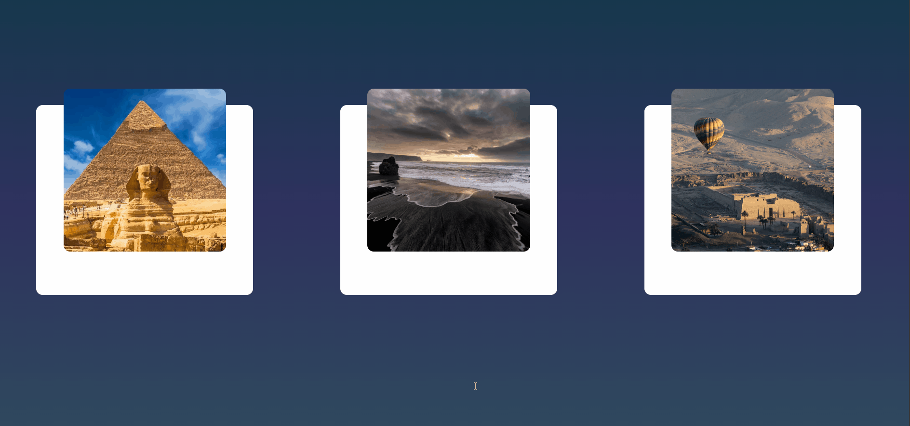

# 🌍 Animated Travel Cards

## 📌 About the Project

An interactive travel cards project built using HTML and CSS as part of my front-end development learning journey.

The project focuses on CSS animations, hover effects, transitions, and visual design.

## 🚀 Live Demo

[Visit the Website](https://mohamedhossam107.github.io/animated-travel-cards/)

## ✨ Features

- Interactive destination cards
- Smooth hover effects
- CSS transitions
- Animated content reveal
- Gradient background
- Travel destination images

## 🛠️ Technologies Used

- HTML5
- CSS3

## 📍 Destinations

- Pyramids, Egypt
- Iceland
- Luxor, Egypt

## 📚 What I Learned

- CSS positioning
- CSS transitions and hover effects
- Card layout design
- Image styling
- Deploying websites using GitHub Pages

## 👨‍💻 Author

Mohamed Hossam

## 🎬 Project Preview

